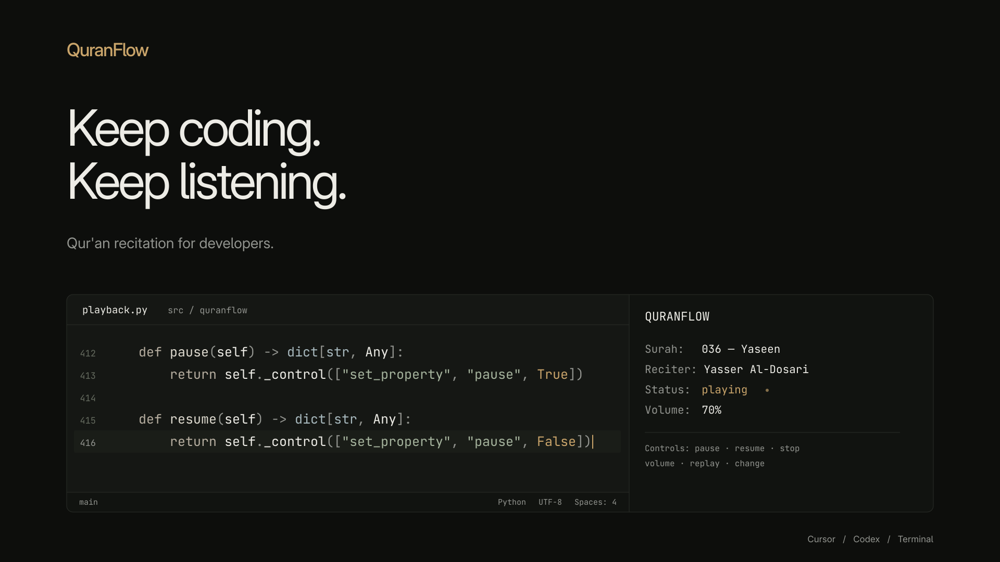

# QuranFlow

Qur'an recitation for developers working in terminals, Claude Code, Cursor and OpenAI Codex.
Choose a Surah and a reciter, then continue coding while mpv streams in the background.

QuranFlow is a small Linux Python CLI with no runtime Python dependencies, web UI,
server or telemetry. Every interface uses the same playback engine.

[](media/quranflow-teaser.mp4)

*30-second teaser ([MP4](media/quranflow-teaser.mp4)). Sound design only; no recitation.*

## Features

- All 114 Surahs, with English and Arabic names, aliases and cautious fuzzy matching.
- Live MP3Quran reciter discovery; each recording edition retains its actual availability.
- Searchable keyboard menu with a plain input fallback and machine-readable output.
- Detached playback, pause, resume, stop, volume, replay and changes of Surah or reciter.
- Remembered selections, validated settings, cached metadata and optional next-Surah autoplay.
- User-scoped CLI, Claude Code skill, Codex Agent Skill and Cursor command installation with conflict backups.
- `--brief` agent mode: one command, one output line, no menus, no follow-up status call.

## Requirements and installation

Linux, Python 3.11+, mpv with JSON IPC and Lua support, HTTPS network access, and a
working audio device. Python's curses module improves the menu but is optional.
Installation also needs either [uv](https://docs.astral.sh/uv/) or Python venv/pip.
No root access is used by the installer.

Install mpv yourself if missing:

```sh
# Arch / Archcraft / Manjaro
sudo pacman -S mpv python
# Debian / Ubuntu
sudo apt install mpv python3 python3-venv
# Fedora
sudo dnf install mpv python3
```

From your cloned QuranFlow repository:

```sh
./install.sh
export PATH="$HOME/.local/bin:$PATH"  # if this directory is not already in PATH
play-quran --version
play-quran
```

The installer creates a private virtual environment at
`~/.local/share/quranflow/venv`, a launcher at `~/.local/bin/play-quran`, a shared
skill at `~/.agents/skills/play-quran`, and a Markdown compatibility command at
`~/.cursor/commands/play-quran.md`. The CLI works from unrelated repositories.
Existing conflicting files are backed up, settings are preserved, and rerunning
the installer updates the package. It reports dependency instructions without
executing them and never edits your shell profile or other repositories.

For an isolated installation or prebuilt wheel:

```sh
./install.sh --home /tmp/quranflow-home --offline --wheel dist/quranflow-0.1.0-py3-none-any.whl
./uninstall.sh --home /tmp/quranflow-home
```

`--home` changes installation destinations; normal playback follows the invoking
user's XDG paths. Set XDG variables as well when running an isolated installed CLI.
`--offline` disables package-index access; a source install still needs cached build
dependencies. A built wheel needs none. The installer verifies the CLI by absolute path
and reports when its directory must be added to PATH.

Uninstall with `./uninstall.sh`. It stops QuranFlow before removing its environment,
removes only owned unmodified files, restores conflict backups, and keeps user
settings/cache. Changed integration files remain for you to inspect.
For just the CLI, `pipx install .` or `uv tool install .` is also possible; these
commands do not install the agent integrations.

## Quick start

```sh
play-quran                         # searchable Surah and reciter menus
play-quran yasin --reciter dosari
play-quran al-kahf --reciter alafasy
play-quran --surah 36 --reciter dosari
play-quran --last                   # reuse remembered choices, no menus
play-quran pause
play-quran resume
play-quran volume 65
play-quran status
play-quran stop
```

Starting a stream returns after mpv startup and playlist submission. Initial status
may be `loading`; use `status` to confirm playback or see a later network/audio error.
Stopping the invoking agent or closing the conversation does not stop detached mpv.
Logout may end your audio session or remove the XDG runtime directory, so cross-login
playback is not guaranteed.

## Claude Code setup

`./install.sh` installs `~/.claude/skills/play-quran/` (the repository also ships it in
`.claude/skills/` for project discovery). Restart Claude Code, then type
`/play-quran yasin --reciter dosari`, `/play-quran pause`, or just ask "play Surah Kahf".

The skill is built to cost almost nothing per request: Claude runs a single pre-approved
command (`play_quran.py --brief …`), gets one status line back, and replies with that
line. No catalog listing, no `--help`, no status polling. With no Surah or reciter given,
the remembered choices play. Arguments are passed as separate words; the skill never
interpolates your text into a shell command.

## Codex setup

`./install.sh` installs the real Agent Skill in the documented user scope,
`~/.agents/skills/play-quran`. The repository also contains
`.agents/skills/play-quran/SKILL.md` for project discovery. Invoke it in Codex:

```text
$play-quran
$play-quran yasin
$play-quran --surah 18 --reciter dosari
$play-quran pause
```

The skill uses its supporting Python launcher, which records the absolute installed
CLI path. It does not assume your working directory is the QuranFlow repository.
An agent's command tool usually has no interactive terminal: when a Surah or reciter
is missing, the skill lists choices and asks you to select them in conversation.
It then executes the same CLI with explicit arguments. In your own terminal the CLI
opens the keyboard menu. The skill never claims audio is playing without checking status.

Codex supports `$play-quran`; this project does not claim a native Codex
`/play-quran` alias. No deprecated custom-prompt adapter is required. Restart Codex
if the newly installed skill does not appear. See the
[official skill documentation](https://learn.chatgpt.com/docs/build-skills).

## Cursor setup

The requested Markdown command lives in `.cursor/commands/play-quran.md`; installation
copies it to the user-level `~/.cursor/commands/` location for command-compatible Cursor
versions. Current Cursor documentation redirects commands guidance to Agent Skills and
also discovers `~/.agents/skills/`. Thus the shared skill supports the same invocation
in current Cursor, even where older command adapters have been superseded:

```text
/play-quran
/play-quran yasin
/play-quran al-kahf
/play-quran 36
/play-quran --surah 18 --reciter dosari
```

Restart/reload Cursor if discovery is delayed. Commands are prompts followed by an
agent, not native media controls. See
[Cursor's current skills and command migration documentation](https://cursor.com/help/customization/skills).
GUI discovery must be tested in your installed Cursor version; remote/cloud agents
play on their execution machine, which may have no audio output to your laptop.

## Selection

Surahs accept IDs 1–114, names such as `Al-Fatihah`, `Al-Baqarah`, `Ya-Sin`,
`Ar-Rahman`, `Al-Kahf`, `Al-Mulk`, `Al-Waqiah`, `Al-Ikhlas`, `An-Nas`, common
variants such as `yasin`, and Arabic names. Punctuation and Arabic vowel marks
are normalized. Fuzzy Surah matching rejects ambiguity. A noninteractive invocation
with no selection returns an actionable error instead of hanging.

Type to filter the menu; use Up/Down or Page Up/Page Down, Enter to choose,
Backspace to edit, Ctrl-U to clear, and Escape to cancel. Menus put remembered
selections first. Without curses or with `TERM=dumb`, enter a search string and
choose a displayed row number. `NO_COLOR` disables status colors; narrow terminals
truncate status lines.

```sh
play-quran surahs
play-quran surahs --json
play-quran reciters
play-quran reciters --surah 18 --json
play-quran reciters --reciter dosari --json
```

The live provider names are displayed verbatim. Known aliases cover Yasser/Yasir
Al-Dosari/Dossary, Mishary Rashid Alafasy, Abdul Rahman Al-Sudais, Maher Al-Muaiqly,
Abdul Basit Abdul Samad, Saad Al-Ghamdi, Muhammad Siddiq Al-Minshawi, Mahmoud Khalil
Al-Husary, Abu Bakr Al-Shatri, Nasser Al-Qatami and Idris Abkar. Other provider reciters
are available by name or ID. An alias works only when its corresponding reciter is
present in the fetched catalog. Near-miss reciter names produce suggestions; they
never silently select another voice.

If several recordings or Riwayat are available, choose an edition in the menu or
pass its provider `moshaf` ID with `--edition`. `reciters --json` lists those IDs and
available Surahs. If a chapter is unavailable, QuranFlow reports alternatives and
requires you to choose another reciter explicitly.

## Command reference

| Command | Behavior |
| --- | --- |
| `play-quran [SURAH]` or `play-quran play [SURAH]` | Choose missing inputs, start a stream |
| `--surah NAME_OR_ID --reciter NAME_OR_ID` | Explicit selection, suitable for agents |
| `--edition ID` | Choose an available recording edition |
| `--volume 0–100` | Volume for this playback |
| `--autoplay` / `--no-autoplay` | Override automatic subsequent-Surah queue |
| `--last` | Reuse remembered Surah, reciter and edition |
| `pause` / `resume` | Set pause explicitly |
| `stop` | Stop only the verified QuranFlow session; safe to repeat |
| `status` | Show now-playing track, state and volume |
| `volume 0–100` | Set current and saved default volume |
| `replay` | Restart current/last session track, including after completion |
| `change 18` | Replace playback with Surah 18 using the current reciter |
| `change --reciter alafasy` | Replace playback using the current Surah |
| `surahs` | List all offline chapter metadata |
| `reciters [--surah N] [--reciter NAME]` | List provider reciters and editions |
| `config` / `config set KEY VALUE` | Read/update settings |
| `--refresh` | Refresh metadata during playback or listing |
| `--json` | JSON output; errors are JSON on stderr |
| `--debug` / `--version` / `--help` | Diagnostics, version, reference |

`change` uses remembered choices when no session is active. Explicit playback choices
update memory after startup. Autoplay queues only later chapter numbers available
in the same edition; it skips unavailable chapters, ends at 114 and never changes
the reciter. `status` follows the actual mpv playlist entry as it advances. Stored
`last_surah` remains the last explicitly selected chapter.

## Configuration

```sh
play-quran config
play-quran config set default_reciter dosari
play-quran config set volume 65
play-quran config set autoplay true
play-quran config set language ar
```

| Key | Default | Accepted values |
| --- | --- | --- |
| `default_reciter` | empty | Provider name/alias/ID; saved as resolved ID |
| `last_surah` | `1` | Integer 1–114 |
| `last_edition` | `0` | Recording ID; 0 means no preference |
| `volume` | `65` | Integer 0–100 |
| `backend` | `mpv` | `mpv` |
| `language` | `eng` | `eng`, `ar`; Surah labels stay bilingual |
| `autoplay` | `false` | `true`, `false` |
| `cache_enabled` | `true` | `true`, `false` |
| `cache_ttl_hours` | `24` | Integer 1–720 |

The reciter menu still appears when `--reciter` is omitted, with your preferred
reciter first. Use `--last` for unattended reuse. Reciter and edition display names
come from the provider's English metadata; `language` controls Surah name order,
not a full translation of command/error text.

Settings are private JSON in `$XDG_CONFIG_HOME/quranflow/config.json`, metadata in
`$XDG_CACHE_HOME/quranflow`, and session state/socket/event/log files in
`$XDG_RUNTIME_DIR/quranflow-runtime`. Defaults are `~/.config`, `~/.cache`, and,
when XDG runtime is absent, `~/.local/state/quranflow/quranflow-runtime`.
Relative XDG paths are ignored. Writes are atomic and settings/session mutations
are serialized. Invalid configuration is reported without overwriting your file.

## Architecture and audio sources

`surahs.py` loads the factual offline index and resolves chapter names;
`reciters.py` handles identity and recording URLs; `provider.py` fetches, validates
and caches the MP3Quran v3 catalog; `config.py` owns settings/XDG paths;
`playback.py` owns the single detached mpv session; `ui.py` owns menus;
`cli.py` joins these modules. Agent adapters only forward arguments.

QuranFlow uses the [official MP3Quran API v3](https://www.mp3quran.net/ar/api).
Each stream is the actual recording server plus a zero-padded chapter filename.
The edition's `surah_list` is authoritative; full coverage is never assumed.
Catalog requests have timeouts, a bounded retry, a size limit and an optional cache.
On failure a validated cache no older than 30 days can be used with a warning.
Only HTTPS recording hosts under `mp3quran.net` with no credentials or alternate
ports are accepted. mpv verifies TLS and keeps bounded streaming buffers rather
than downloading the whole Surah before playback.

mpv JSON IPC is protected by filesystem permissions and peer/process identity
checks. A tiny Lua script inside mpv records EOF/errors; no Python daemon remains.
New playback replaces the previous QuranFlow session. Stop sends a verified IPC
quit command rather than signaling stored PIDs. ffplay was investigated but omitted
because it lacks mpv's supported JSON IPC interface for reliable detached controls.

[AlQuran Cloud](https://alquran.cloud/api) supplied factual chapter metadata and was
investigated for secondary audio. No automatic audio fallback is implemented:
this release cannot establish equivalent reciter/edition identity for every requested
MP3Quran recording. On a network error it reports the error instead of changing voices.

Audio is streamed directly from MP3Quran and attributed to its reciter and edition.
No recording is bundled or redistributed. The MIT license covers original QuranFlow
code/documentation, **not third-party recordings**. Consult MP3Quran and rights holders
for reuse permission; API availability is not an unrestricted audio license.
Normal provider requests disclose your IP and requested audio to the provider.
Research/version evidence is recorded in [docs/decisions](docs/decisions).

## Troubleshooting and limitations

- **No sound:** check your PipeWire/PulseAudio/ALSA output and mpv in a normal terminal.
  `status` can be `loading` while a stream connects; an audio-device error appears later.
- **No mpv:** install the distribution package, then retry. ffplay is not a substitute.
- **DNS, TLS or catalog errors:** check connectivity and your clock/CA certificates;
  use `reciters --refresh`. Never disable TLS verification to bypass a failure.
- **No IPC socket:** sandbox policy may forbid Unix sockets. Run in a local terminal
  permitting mpv IPC. Inspect the current private `.log` file in the runtime directory.
- **Path too long:** choose a short absolute `XDG_RUNTIME_DIR` owned by your user.
- **No interactive terminal:** specify both selections and, if needed, `--edition`;
  use `--json` lists in agent tools. `--last` requires an existing remembered selection.
- **Stale/malformed state:** read the error first. Do not kill all mpv processes;
  only QuranFlow's authenticated session may be controlled. Inspect private session
  state before manually moving malformed files aside.
- **Agent sandbox cannot write home:** install from your normal terminal. Agent-side
  playback still needs network, audio and Unix socket permissions on the execution host.
- **Agent GUI unavailable:** packaged instructions can be validated offline; actual
  slash/skill discovery requires Cursor/Codex in your installation.

Linux is the only supported platform in this release. Provider availability and rights
may change; neither every reciter nor every chapter is guaranteed. No gapless playback,
system tray, browser, offline audio library or across-logout playback is promised.

## Development and verification

```sh
python3 -m venv .venv
.venv/bin/python -m pip install -e '.[dev]'
.venv/bin/python -m pytest
.venv/bin/ruff check .
.venv/bin/ruff format --check .
.venv/bin/python -m pip wheel --no-deps .
```

GitHub Actions checks Python 3.11–3.14, formatting/lint, offline tests, wheel/sdist
contents and fresh-wheel CLI behavior. Tests do not request live audio or network.
See [CONTRIBUTING.md](CONTRIBUTING.md), [SECURITY.md](SECURITY.md), and the
[manual smoke procedure](docs/SMOKE_TEST.md).

Initial implementation was verified in a managed sandbox: shell DNS, Unix socket
creation and writes to normal home installation paths were unavailable. Package,
mocked control and isolated installation checks are distinct from live audible
playback and GUI discovery. The local verification report records actual results
and publication status in [docs/VERIFICATION.md](docs/VERIFICATION.md); do not infer
publication or audible playback from generated files.

## License

[MIT](LICENSE) for original source code and documentation only. Third-party audio
and factual provider data are attributed above and are not relicensed by QuranFlow.
